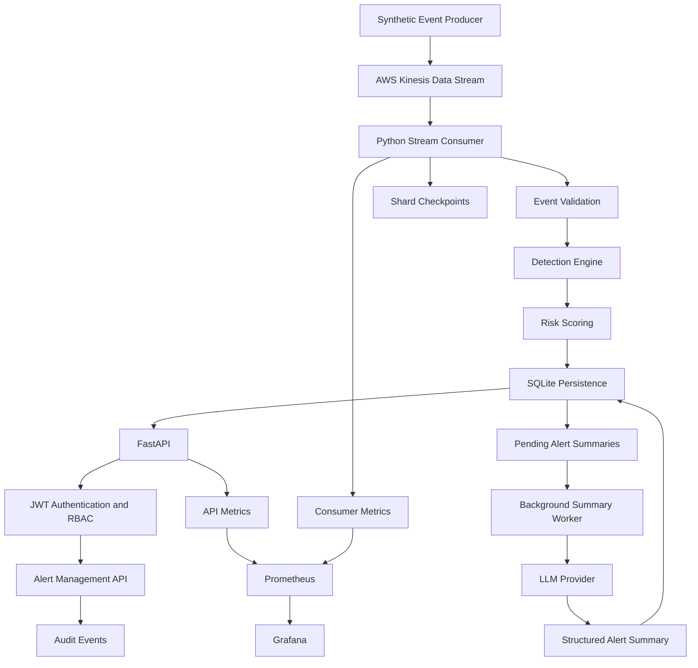

# AI-Assisted Security Event Detection Platform

A security event processing platform that ingests streaming events, detects suspicious activity using deterministic rules, assigns risk scores, and generates AI-assisted alert summaries. Built with Python, AWS Kinesis, FastAPI, SQLite, Prometheus, and Grafana.

The platform is designed to demonstrate practical cybersecurity engineering concepts, including event-driven processing, threat detection, risk scoring, checkpoint-based recovery, role-based access control (RBAC), auditability, and operational observability.

> **Project status:** In progress. The core ingestion, detection, persistence, API security, and monitoring components have been implemented. Grafana datasource provisioning and the planned DynamoDB migration remain areas for further work.

## Table of Contents

- [Overview](#overview)
- [Key Features](#key-features)
- [Architecture](#architecture)
- [Technology Stack](#technology-stack)
- [Event Processing Pipeline](#event-processing-pipeline)
- [Detection and Risk Scoring](#detection-and-risk-scoring)
- [AI-Assisted Alert Summarization](#ai-assisted-alert-summarization)
- [Security Design](#security-design)
- [Observability](#observability)
- [Project Structure](#project-structure)
- [Prerequisites](#prerequisites)
- [Getting Started](#getting-started)
- [Running the Application](#running-the-application)
- [API Overview](#api-overview)
- [Configuration](#configuration)
- [Testing and Code Quality](#testing-and-code-quality)
- [Reliability and Failure Handling](#reliability-and-failure-handling)
- [Design Decisions and Trade-offs](#design-decisions-and-trade-offs)
- [Known Limitations](#known-limitations)
- [Roadmap](#roadmap)
- [License](#license)

## Overview

Security-sensitive applications generate large volumes of authentication, authorization, and resource-access events. Processing these events efficiently requires a pipeline that can ingest data continuously, identify suspicious patterns, persist findings, and provide analysts with actionable information.

This project implements a prototype security event detection platform that separates deterministic detection from AI-assisted investigation support.

The detection pipeline uses explicit rules and risk scoring to identify suspicious activity. An optional background worker generates structured alert summaries using an LLM, keeping AI inference outside the event-processing critical path.

The current implementation uses AWS Kinesis for streaming ingestion and SQLite for local persistence. The storage layer is intended to evolve toward DynamoDB as a subsequent development phase.

### Goals

- Ingest synthetic security events through a managed streaming service.
- Process events using a custom Python consumer.
- Detect suspicious authentication and access patterns.
- Calculate risk scores and classify alert severity.
- Persist events, alerts, and consumer checkpoints.
- Expose secured alert-management APIs.
- Enforce role-based access and record auditable state changes.
- Generate AI-assisted explanations and recommended actions.
- Export operational metrics for Prometheus and Grafana.

## Key Features

| Capability | Description |
|---|---|
| Streaming ingestion | Publishes synthetic security events to AWS Kinesis. |
| Custom consumer | Reads Kinesis shards, validates records, and processes batches. |
| Deterministic detection | Applies configurable rules to identify suspicious activity. |
| Risk scoring | Assigns risk scores and severity to detected activity. |
| Persistent storage | Stores events, alerts, checkpoints, and audit events in SQLite. |
| Recovery support | Uses shard checkpoints and idempotent persistence techniques to support recovery. |
| JWT authentication | Validates signed tokens for protected API endpoints. |
| Role-based access control | Separates analyst and administrator permissions. |
| Alert lifecycle management | Supports authorized alert acknowledgement and resolution. |
| Audit trail | Records successful alert status transitions. |
| AI-assisted summaries | Generates structured explanations, evidence, and recommended actions. |
| Metrics | Exposes API and consumer metrics for Prometheus scraping. |
| Infrastructure as code | Provisions AWS Kinesis resources using Terraform. |
| Synthetic data generation | Produces test events without requiring real customer data. |

## Architecture



### Component responsibilities

**1. Event producer**

Generates synthetic security events and publishes them to the Kinesis stream using batch writes.

**2. AWS Kinesis**

Acts as the managed streaming layer between event production and consumption. The current Terraform configuration provisions an on-demand stream with 24-hour retention.

**3. Python consumer**

Discovers shards, retrieves records, validates events, invokes the detection engine, persists results, and advances checkpoints after durable persistence.

**4. Detection engine**

Evaluates incoming events against deterministic detection rules and calculates risk scores for generated findings.

**5. SQLite storage**

Persists processed events, alerts, failed-login history, shard checkpoints, summary-job state, and audit records.

**6. FastAPI service**

Provides authenticated endpoints for identity inspection, alert retrieval, alert status transitions, and administrative audit access.

**7. AI summary worker**

Processes pending alerts asynchronously and stores structured summaries. It is not required for deterministic detection to operate.

**8. Prometheus and Grafana**

Collect and visualize consumer throughput, rejected records, alerts, processing latency, consumer errors, and API traffic.

## Technology Stack

| Category | Technologies |
|---|---|
| Language | Python |
| Dependency management | uv |
| Streaming | AWS Kinesis Data Streams |
| Infrastructure as code | Terraform |
| API framework | FastAPI |
| Authentication | JWT, PyJWT |
| Validation | Pydantic |
| Persistence | SQLite |
| AI integration | OpenAI API, Responses API |
| Metrics | Prometheus client library |
| Monitoring | Prometheus, Grafana |
| Containerization | Docker, Docker Compose |
| Testing | pytest |
| Code quality | Ruff, mypy |

## Event Processing Pipeline

The ingestion and detection pipeline follows this sequence:

1. The producer generates a synthetic security event.
2. The producer serializes and publishes the event to Kinesis.
3. The consumer reads records from a Kinesis shard.
4. Each record is validated against the event schema.
5. Valid events are evaluated by the detection engine.
6. Detection findings receive risk scores and severity classifications.
7. Events, alerts, and the corresponding checkpoint are persisted.
8. The consumer advances its in-memory iterator and continues polling.
9. Persisted alerts can be retrieved through the API or processed by the summary worker.

### Event schema

Security events use a validated schema containing fields such as:

| Field | Purpose |
|---|---|
| `event_id` | Unique event identifier. |
| `timestamp` | Event timestamp. |
| `event_type` | Type of activity, such as login or resource access. |
| `outcome` | Result, such as success, failure, or denied. |
| `source_ip` | Source IP address. |
| `user_id` | Identity associated with the event. |
| `resource` | Resource involved in the activity. |
| `metadata` | Additional event attributes. |

The schema validates core fields before events enter the detection pipeline. Synthetic IP addresses use documentation-reserved address ranges.

## Detection and Risk Scoring

The detection engine uses deterministic rules to identify suspicious activity.

### Implemented detection rules

**Brute-force detection**

Tracks failed login attempts within a configurable rolling time window and identifies repeated authentication failures.

**Unauthorized access detection**

Identifies events representing denied or unauthorized access.

**Denylist detection**

Evaluates events against configured denylist conditions.

### Risk scoring

Detected findings receive risk scores. Scores are mapped to severity categories to help prioritize investigation.

The current brute-force rule has a base risk score of 70. Final severity depends on the configured scoring and classification thresholds.

Risk scores are intended to prioritize alerts, not to establish that malicious activity has been conclusively proven.

### Design principles

- Keep detection deterministic and testable.
- Avoid making LLM inference a prerequisite for detecting threats.
- Preserve event and alert records for investigation.
- Separate detection logic from transport and persistence.
- Make thresholds configurable rather than hardcoding every detection parameter.

## AI-Assisted Alert Summarization

The optional summarization component enriches detected alerts with structured investigative context.

The worker uses an LLM provider to generate an `AlertSummary` containing:

- **Explanation:** A human-readable description of the alert.
- **Evidence:** Relevant observations supporting the alert.
- **Recommended actions:** Suggested investigative or remediation steps.

The summary is persisted with the alert and its processing status.

### Processing flow

1. A deterministic detection rule creates an alert.
2. The alert is persisted with a pending summary status.
3. The background worker retrieves eligible alerts.
4. The worker calls the configured LLM provider.
5. The generated response is validated against the expected structured schema.
6. A successful summary is persisted; failures are recorded for later handling.

### Why AI is outside the detection path

Separating AI summarization from deterministic detection avoids making event ingestion dependent on model availability or inference latency.

An LLM-generated summary is advisory. It should not independently authorize access, resolve an incident, or replace the underlying event evidence.

The OpenAI provider uses the Responses API with `gpt-4o-mini`, a request timeout, limited retries, and `store=False`.

AI summaries require a valid API key and available API quota. The worker is optional and can be skipped during normal pipeline development.

## Security Design

Security is addressed at the event, API, persistence, and infrastructure layers.

### JWT authentication

Protected API endpoints validate signed JWTs, including issuer, audience, expiration, subject, and role claims.

Authentication failures are rejected before protected operations are executed.

### Role-based access control

The current API distinguishes between analyst and administrator roles.

| Operation | Analyst | Administrator |
|---|---|---|
| View alerts | Yes | Yes |
| Acknowledge an open alert | Yes | Yes |
| Resolve an alert | No | Yes |
| Read audit events | No | Yes |

Actual access is enforced by API dependencies and authorization checks.

### Alert lifecycle

The supported transitions are:

```text
open ──────────────> acknowledged
  │                        │
  └──> resolved ────────────┘
             (admin only)
```

More precisely, the allowed transitions are:

- `open` → `acknowledged`
- `open` → `resolved` — administrator only
- `acknowledged` → `resolved` — administrator only

Resolved alerts are terminal in the current implementation.

### Auditability

Successful alert status transitions are recorded with associated audit information. The audit API is restricted to administrators.

The current implementation does not record every failed authorization attempt or rejected transition in the audit table.

### Infrastructure security

Terraform provisions a Kinesis stream with AWS-managed Kinesis encryption and a 24-hour retention period. Producer and consumer IAM policies are defined separately.

The application should use least-privilege AWS credentials and avoid embedding credentials in source code.

### Important security note

This repository is a development project, not a production-certified security product. Production deployment would require additional work on secrets management, IAM policy attachment and validation, network boundaries, rate limiting, audit coverage, data retention, and operational access controls.

## Observability

The application exposes Prometheus metrics for the consumer and API.

### Consumer metrics

| Metric | Purpose |
|---|---|
| `security_events_processed_total` | Total successfully processed events. |
| `security_records_rejected_total` | Rejected or invalid records. |
| `security_alerts_created_total` | Alerts created by detection. |
| `security_consumer_batches_total` | Consumer batches processed. |
| `security_consumer_errors_total` | Consumer processing errors. |
| `security_consumer_batch_processing_seconds` | Batch-processing latency distribution. |
| `security_summary_attempts_total` | Summary generation attempts. |
| `security_summary_successes_total` | Successful summary generations. |
| `security_summary_failures_total` | Failed summary generations. |

### API metrics

| Metric | Purpose |
|---|---|
| `security_api_requests_total` | HTTP request count, labeled by method and status. |
| `security_api_request_duration_seconds` | API request duration distribution. |

Summary-worker metrics are currently in-process. Because the worker is a short-lived process, those counters do not provide durable, cross-process metrics after the worker exits.

### Monitoring endpoints

| Component | Endpoint |
|---|---|
| API metrics | `http://localhost:8000/metrics` |
| Consumer metrics | `http://localhost:9101/` |
| Prometheus | `http://localhost:9090` |
| Grafana | `http://localhost:3000` |

Prometheus configuration is located at `monitoring/prometheus/prometheus.yml`. Grafana datasource and dashboard provisioning files are located under `monitoring/grafana/`.

## Project Structure

```text
ai-security-event-platform/
├── app/
│   ├── common/
│   │   ├── config.py
│   │   └── schemas.py
│   ├── producer/
│   │   └── main.py
│   ├── consumer/
│   │   └── main.py
│   ├── detection/
│   │   ├── engine.py
│   │   ├── rules.py
│   │   └── risk.py
│   ├── storage/
│   │   ├── checkpoints.py
│   │   └── detection_store.py
│   ├── summarization/
│   │   ├── service.py
│   │   ├── openai_provider.py
│   │   └── worker.py
│   ├── api/
│   │   ├── main.py
│   │   ├── auth.py
│   │   ├── dependencies.py
│   │   ├── alerts.py
│   │   ├── alert_actions.py
│   │   └── audit.py
│   └── observability/
│       └── metrics.py
├── terraform/
├── monitoring/
│   ├── prometheus/
│   │   └── prometheus.yml
│   └── grafana/
│       ├── dashboards/
│       │   └── security-overview.json
│       └── provisioning/
│           ├── dashboards/
│           │   └── dashboards.yml
│           └── datasources/
│               └── prometheus.yml
├── scripts/
│   ├── create_test_alert.py
│   └── generate_test_token.py
├── tests/
│   ├── unit/
│   └── integration/
├── docs/
├── compose.yaml
├── pyproject.toml
├── uv.lock
├── .env.example
└── README.md
```

*The tree represents the intended project layout. Individual files may differ as the project evolves.*

## Prerequisites

Install or configure the following before running the project:

- Python and `uv`
- Docker Desktop with Docker Compose
- AWS CLI or another supported AWS credential provider
- AWS credentials with appropriate Kinesis permissions
- Terraform, if provisioning AWS infrastructure
- An OpenAI API key only if AI summarization is required

The current AWS configuration uses the `ap-south-1` region and a Kinesis stream named `security-events-dev`.

## Getting Started

### 1. Clone the repository

```bash
git clone <your-repository-url>
cd ai-security-event-platform
```

Replace the repository URL with your actual Git remote.

### 2. Install dependencies

```powershell
uv sync
```

### 3. Configure environment variables

Copy the example configuration if available:

```powershell
Copy-Item .env.example .env
```

Update `.env` with your local settings.

At minimum, verify the AWS region, stream name, SQLite path, detection thresholds, and JWT settings. Add an LLM API key only if you intend to run AI summarization.

Never commit `.env` or real credentials to version control.

### 4. Configure AWS credentials

Use an AWS CLI profile or another supported credential provider. For example:

```powershell
aws configure
```

Verify the active identity:

```powershell
aws sts get-caller-identity
```

Confirm that the identity has access to the configured Kinesis stream.

### 5. Provision the Kinesis stream

If infrastructure is not already provisioned, initialize and review Terraform:

```powershell
cd terraform
terraform init
terraform validate
terraform plan
```

Apply only after reviewing the proposed changes:

```powershell
terraform apply
```

Return to the repository root:

```powershell
cd ..
```

**Caution:** The Terraform configuration includes `prevent_destroy = true` for the Kinesis stream. Review infrastructure changes carefully. AWS resources may incur charges even when no events are being processed.

## Running the Application

### 1. Start monitoring services

From the repository root:

```powershell
docker compose -f compose.yaml up -d
```

Check status:

```powershell
docker compose -f compose.yaml ps
```

### 2. Start the API

Open a separate PowerShell terminal:

```powershell
uv run uvicorn app.api.main:app --reload
```

Open `http://localhost:8000/docs` to inspect the API.

### 3. Start the consumer

Open another terminal:

```powershell
uv run python -m app.consumer.main
```

The consumer should remain running to continuously poll the Kinesis stream.

### 4. Generate synthetic events

Open another terminal:

```powershell
uv run python -m app.producer.main --count 100
```

Check consumer logs and metrics to verify processing.

### 5. Generate a development JWT

If required for local API testing, run:

```powershell
uv run python scripts/generate_test_token.py
```

Use the generated token with the API's Bearer authentication.

The script creates a development token for testing. It is not an identity provider and should not be used as a production authentication mechanism.

### 6. Run AI summaries

When pending alerts exist and your LLM configuration is valid:

```powershell
uv run python -m app.summarization.worker --limit 10
```

This command may incur API usage charges.

## API Overview

The FastAPI application currently exposes the following API areas.

| Endpoint | Method | Purpose |
|---|---|---|
| `/health` | GET | Health check. |
| `/api/v1/me` | GET | Inspect the authenticated principal. |
| `/api/v1/admin/check` | GET | Verify administrator access. |
| `/api/v1/alerts` | GET | List alerts. |
| `/api/v1/alerts/{alert_id}` | GET | Retrieve an alert. |
| `/api/v1/alerts/{alert_id}/status` | PATCH | Perform an authorized alert status transition. |
| `/api/v1/audit-events` | GET | Retrieve audit events; administrator only. |
| `/metrics` | GET | Export API Prometheus metrics. |

The health and metrics endpoints are operational endpoints; protected application routes require valid authentication according to their configured dependencies.

Use the interactive Swagger UI at `http://localhost:8000/docs` to inspect request and response schemas.

## Configuration

Configuration is managed through the application settings module and environment variables.

| Setting | Purpose |
|---|---|
| `APP_ENV` | Application environment. |
| `AWS_REGION` | AWS region; currently `ap-south-1`. |
| `KINESIS_STREAM_NAME` | Kinesis stream; currently `security-events-dev`. |
| `SQLITE_PATH` | Local SQLite database path. |
| `BRUTE_FORCE_THRESHOLD` | Failed-login threshold. |
| `BRUTE_FORCE_WINDOW` | Rolling detection window. |
| `LLM_API_KEY` | Optional API key for AI summaries. |
| `JWT_SECRET` | Secret used to validate development JWTs. |
| `JWT_ISSUER` | Expected JWT issuer. |
| `JWT_AUDIENCE` | Expected JWT audience. |

Consult `app/common/config.py` for the exact environment-variable names, defaults, and validation rules in the current implementation.

Use strong, unique JWT secrets and keep them outside source control.

## Testing and Code Quality

Run the test suite:

```powershell
uv run pytest
```

Run tests with coverage:

```powershell
uv run pytest --cov=app --cov-report=term-missing
```

Run Ruff lint checks:

```powershell
uv run ruff check .
```

Format code:

```powershell
uv run ruff format .
```

Run static type checking if configured:

```powershell
uv run mypy app
```

Run the test suite after changing detection rules, checkpoint logic, storage transactions, authorization policies, or alert transitions.

## Reliability and Failure Handling

### Checkpointing

The consumer stores shard checkpoint information in SQLite. Checkpoints are advanced after the associated records have been durably persisted.

This ordering reduces the chance of skipping records following a restart.

### Duplicate handling

The storage layer uses identifiers and persistence logic to reduce duplicate processing effects when records are replayed. This is an at-least-once processing design, not a guarantee of end-to-end exactly-once delivery.

### Invalid records

Events that fail schema validation are rejected and tracked through the consumer's rejection metrics.

### AI provider failures

AI summary generation is separate from deterministic detection. Provider errors are handled by the worker and reflected in summary status and metrics while the process remains active.

### Storage transactions

SQLite transactions help keep related event, alert, and checkpoint changes consistent within the local storage implementation.

## Design Decisions and Trade-offs

### Why Kinesis?

Kinesis provides a managed streaming abstraction with shard-based consumption and configurable retention. It allows the project to focus on consumer correctness, checkpointing, and detection logic without implementing a message broker.

### Why a custom consumer?

A custom consumer makes shard iteration, checkpointing, record validation, and recovery behavior explicit and testable.

### Why SQLite first?

SQLite minimizes infrastructure complexity and cost during local development. It makes the project easy to run and inspect while the data model and processing behavior are being refined.

It is not intended to support multiple application instances sharing a single local database as a production storage architecture.

### Why deterministic rules plus AI?

Deterministic rules provide explainable, repeatable detection behavior. AI summaries help communicate findings and suggest investigation steps without placing model availability on the detection critical path.

### Why Prometheus?

Prometheus supports metric collection and query-based monitoring, while Grafana provides dashboards for inspecting operational behavior.

## Known Limitations

- SQLite is currently the persistence backend; DynamoDB migration is pending.
- The current storage design is intended for a single-instance local demonstration.
- End-to-end exactly-once processing is not guaranteed.
- Summary-worker metrics are process-local and are not durable across worker restarts.
- The current audit trail focuses on successful alert status transitions rather than all security-relevant actions.
- Detection rules are a prototype and require tuning and additional validation against representative datasets.
- The synthetic producer does not replace real telemetry ingestion or production threat-intelligence feeds.
- Grafana datasource provisioning is under investigation. The datasource configuration file has temporarily been renamed to allow Grafana to start, so provisioned dashboards may not currently display metrics.
- The project has not been established as production-ready or independently security-audited.

## Roadmap

### Reliability and storage

- [ ] Complete DynamoDB storage implementation.
- [ ] Define and validate DynamoDB partition and sort key design.
- [ ] Improve checkpoint and retry handling.
- [ ] Strengthen idempotency across event replays.
- [ ] Add explicit concurrency and recovery tests.

### Detection engineering

- [ ] Expand detection rules and risk-scoring calibration.
- [ ] Add richer detection evidence and alert deduplication.
- [ ] Improve rule-level test coverage.
- [ ] Evaluate detection quality against labeled synthetic datasets.

### AI-assisted investigation

- [ ] Improve summary-worker leasing and retry handling.
- [ ] Persist and export summary-worker metrics.
- [ ] Validate summary quality and grounding against alert evidence.
- [ ] Add stronger safeguards for untrusted event content.

### Observability

- [ ] Fix Grafana datasource provisioning.
- [ ] Restore reliable dashboard provisioning.
- [ ] Add alert-processing latency and backlog metrics.
- [ ] Add operational alerts for consumer failures and processing delays.
- [ ] Add load and failure-injection tests.

### Security and deployment

- [ ] Expand audit coverage for denied operations.
- [ ] Tighten IAM permissions and validate least-privilege access.
- [ ] Add API rate limiting and production secret management.
- [ ] Add CI checks for tests, linting, type checking, and dependency security.
- [ ] Document production deployment and incident-response procedures.

## 🎥 Project Demo

Watch the full walkthrough of the AI-Assisted Security Event Detection Platform:

[](https://www.youtube.com/watch?v=ZLklQB3kGtU)

**[▶ Watch the full demo](https://www.youtube.com/watch?v=ZLklQB3kGtU)**

## License

This project is licensed under the [MIT License](LICENSE).
